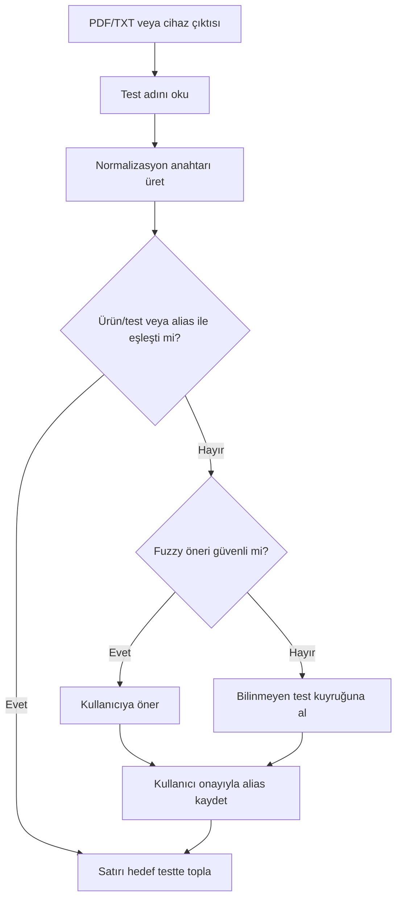

# Test Adı Akıllı Eşleştirme Kurulum Planı

## Amaç
PDF/TXT, kümülatif rapor ve cihaz üstü çıktılarında aynı testin farklı yazımlarla gelmesini tek ürüne/teste bağlamak. Örnekler:

- `A-HCV 2`, `A-HCV II`, `a.hcv-2` → aynı teknik anahtar: `ahcv2`
- `Syphil-2`, `Syphilis` → normalizasyonla değil, alias/sözlük eşleştirmesiyle aynı test
- `DIGO` → sistemde karşılığı yoksa bilinmeyen test havuzuna düşmeli

## Mimari Katmanlar

1. **Normalizasyon**
   - Büyük/küçük harf farkı kaldırılır.
   - Türkçe karakterler ASCII karşılığına çevrilir.
   - Nokta, tire, boşluk ve benzeri ayraçlar silinir.
   - Tek başına kullanılan Roma rakamları sayıya çevrilir (`II` → `2`).

2. **Alias / Takma Ad Sözlüğü**
   - Ürün veya test tanımı üzerinde `testAdiAliases` gibi bir liste tutulur.
   - Kullanıcı bir defa `Syphil-2` → `Syphilis` dediğinde bu alias listeye eklenir.
   - Sonraki dosyalarda otomatik eşleşir.

3. **Bulanık Öneri**
   - Levenshtein benzerliğiyle küçük yazım hataları öneri olarak yakalanır.
   - Varsayılan eşik yüksek tutulur (`0.90`); düşük güvenli terimler otomatik bağlanmaz.

4. **Bilinmeyen Test Kuyruğu**
   - Eşleşmeyen her test adı kaynak, hastane, dönem ve ham ad ile kaydedilir.
   - Panelde kullanıcı hedef ürün/test seçer.
   - Sistem ham adı alias listesine ekleyerek kendi kendine öğrenir.

## Uygulama Adımları

1. Ortak eşleştirme çekirdeği oluşturuldu: `src/lib/qore-hesaplama/test-name-matcher.ts`.
2. Kümülatif ve cihaz üstü toplama motorları normalizasyon anahtarını kullanacak şekilde güncellendi.
3. Örnek hastane verilerindeki riskli adlandırmalar için birim testleri eklendi.
4. Sonraki fazda yönetim paneline alias düzenleme alanı ve bilinmeyen test kuyruğu eklenmeli.

## Operasyonel Akış

