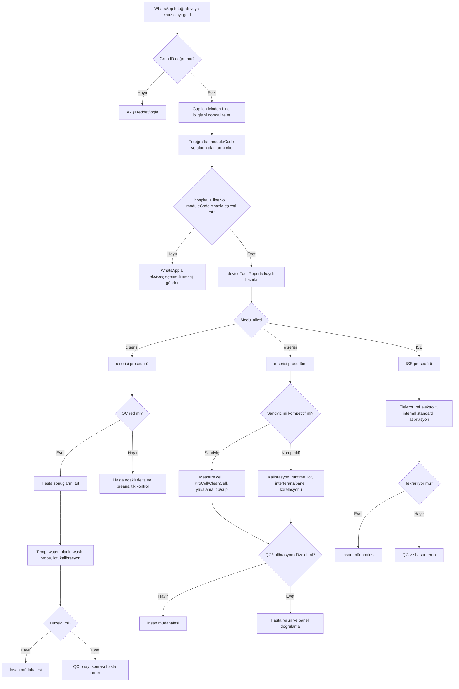

# WhatsApp Arıza AI Master Dokümanı

## Amaç ve kapsam

Bu master doküman, Qore içindeki WhatsApp kaynaklı arıza alım sürecinin hangi gruptan veri okuyacağını, gelen fotoğraf + açıklama verisini nasıl cihazla eşleştireceğini ve Roche biyokimya/hormon teknik bilgisini AI yorum katmanına nasıl taşıyacağını tanımlar.

## WhatsApp kaynak grubu

WhatsApp arıza fotoğrafları yalnızca aşağıdaki grup kimliğinden okunacaktır:

```json
{
  "id": "905362840155-1615537145@g.us",
  "name": "Göztepe Merkez lab Line",
  "isReadOnly": false,
  "isGroup": true
}
```

Bu grup Qore içinde varsayılan olarak **Göztepe Merkez** laboratuvar kaynağı kabul edilir. Farklı gruplar veya bireysel sohbetlerden gelen mesajlar bu otomatik arıza alım akışına dahil edilmemelidir.

## Kullanıcı mesaj standardı

Kullanıcılar WhatsApp grubuna arıza fotoğrafı gönderirken fotoğraf açıklamasına veya alt mesajına Line bilgisini yazmalıdır.

Kabul edilecek örnekler:

- `Line 7`
- `Line-7`
- `line7`
- `L7`
- `Hat 7`

AI alım katmanı bu ifadeleri normalize ederek `lineNo: 7` gibi sayısal bir alana dönüştürmelidir.

## Cihaz eşleştirme kuralı

Otomatik cihaz/seri no eşleştirmesi aşağıdaki anahtarla yapılır:

```text
WhatsApp group id -> hospital/lab
caption/text -> lineNo
image OCR/AI -> moduleCode
hospital/lab + lineNo + moduleCode -> deviceId + serial
```

Örnek:

```text
Grup: 905362840155-1615537145@g.us -> Göztepe Merkez
Mesaj: Line 7 -> lineNo=7
Fotoğraf: Module AU3 -> moduleCode=AU3
Eşleşme: Göztepe Merkez + Line 7 + AU3 -> cihaz ve seri no
```

Fotoğrafta `AU1`, `AU2`, `AU3`, `AU4` gibi modül bilgisi okunabildiğinde bu değer laboratuvar içindeki cihaz/modül adıyla eşleştirilir. Böylece kullanıcıdan seri numarası yazması istenmeden seri numarası cihaz kaydından bulunur.

## Otomatik arıza kaydı için önerilen veri modeli

```ts
{
  source: 'whatsapp_ai',
  sourceGroupId: '905362840155-1615537145@g.us',
  sourceGroupName: 'Göztepe Merkez lab Line',
  hospitalName: 'Göztepe Merkez',
  lineNo: 7,
  moduleCode: 'AU3',
  deviceId: '...',
  deviceName: '...',
  serial: '...',
  faultCode: '006-000012',
  faultName: 'Sample Probe',
  faultLevel: 'E.Stop',
  description: 'Sampling tip was dropped when sample probe was moving.',
  remedy: ['Remove the fallen tip', 'Perform Reset on Utility > Maintenance'],
  faultType: 'teknik_servis',
  priority: 'kritik',
  imageUrl: '...',
  aiConfidence: 0.0,
  status: 'atama_bekliyor'
}
```

## Executive summary

Bu rapor, yüklenen Roche arşivindeki biyokimya ve hormon insert dosyalarını, Qore içindeki bir AI motorunun teknik ve aplikasyon arızalarını sistematik biçimde okuyup yorumlayabilmesi için “test bazlı ama AI-uygulanabilir” bir master dokümana dönüştürür. Arşiv içeriği pratikte iki ana platform ailesine ayrılır: biyokimya testleri ağırlıkla cobas c 303/503/703 klinik kimya modüllerine, hormon testleri ise cobas e 402/801 Elecsys immünoassay modüllerine karşılık gelir.

AI açısından en yüksek getiriyi sağlayan yaklaşım “tek test” yerine “arıza paterni ailesi” yaklaşımıdır. Bu nedenle AI motoru önce arıza kapsamını belirlemelidir: birden fazla assay aynı anda bozuluyorsa modül/altyapı, tek assay etkileniyorsa reaktif-kalibrasyon-aplikasyon, QC normal ama hasta sonucu anormalse preanalitik/interferans ekseni önceliklendirilmelidir.

## Kapsam ve kaynak temeli

Bu çalışma Roche Türkçe insert dosyalarını çekirdek kaynak olarak kabul eder. Biyokimya ve hormon kapsamı dışındaki seroloji, viroloji ve özel testler bu master dokümanda kapsam dışıdır. Basic Wash, ISE Diluent Gen.2, ISE Internal Standard Gen.2 ve ISE Reference Electrolyte gibi tek test olmayan fakat modül düzeyinde arıza çıkarabilen yardımcı sarflar AI kök neden ağacında alt sistem olarak değerlendirilmelidir.

Eksik yerel bilgiler açıkça işaretlenmelidir. Laboratuvardaki gerçek cihaz modeli eşlemesi, Roche servis loglarının yerel formatı ve laboratuvar SOP tabanlı QC eşikleri paylaşılmadığında AI “belirtilmemiş” veya “parametrik eşik gerekli” etiketiyle ilerlemelidir.

## Biyokimya test matrisi

Biyokimya tarafı esas olarak cobas c 303/503/703 çizgisindeki fotometrik klinik kimya testlerinden oluşur. AI, test-spesifik satırları yorumlarken önce modül-seviyesi sinyalleri değerlendirmelidir: HIL/serum indeksleri, pıhtı ve sıvı seviye algılama, reaktif yönetimi, reaksiyon sıcaklığı, su kalitesi, fotometrik blank, wash ve örnek probu.

| Test | Cihaz modeli | Roche dosya referansı | Çalışma prensibi | Kritik adımlar | Sık teknik arıza paterni | Sık aplikasyon hatası | AI kök neden odağı |
| --- | --- | --- | --- | --- | --- | --- | --- |
| Albumin Gen.2 | cobas c 303/503/703 | Insert.ALB2.08056692500.V7.tr | Boya/kompleks absorbansı | Lot sonrası kalibrasyon; HIL; örnek hacmi | Aspirasyon / fotometre / wash / reaktif | Yanlış tüp/matris; kalibrasyon atlama | Ortak c-modülü veya lot |
| ALP IFCC Gen.2 | cobas c 303/503/703 | Insert.ALP2.08056757500.V9.tr | Enzimatik fotometri | Reaksiyon sıcaklığı ve substrat stabilitesi | Aspirasyon / fotometre / wash / reaktif | Yanlış tüp/matris; kalibrasyon atlama | Ortak c-modülü veya lot |
| ALT IFCC II | cobas c 303/503/703 | Insert.ALTP2.08104697500.V8.tr | IFCC enzimatik hız | P-5-P aktivasyonu; düşük volüm/pipetleme hassasiyeti | Aspirasyon / fotometre / wash / reaktif | Yanlış tüp/matris; kalibrasyon atlama | Ortak c-modülü veya lot |
| AST IFCC P-5-P | cobas c 303/503/703 | Insert.ASTP2.08104719500.V8.tr | IFCC enzimatik hız | P-5-P aktivasyonu; hemoliz etkisi | Aspirasyon / fotometre / wash / reaktif | Yanlış tüp/matris; kalibrasyon atlama | Ortak c-modülü veya lot |
| Direkt bilirubin Gen.2 | cobas c 303/503/703 | Insert.BILD2.08056951500.V7.tr | Boya/kompleks absorbansı | Işığa duyarlılık | Aspirasyon / fotometre / wash / reaktif | Işık maruziyeti; yanlış tüp/matris | Önce preanalitik |
| Total bilirubin Gen.3 | cobas c 303/503/703 | Insert.BILT3.10421436500.V1.tr | Boya/kompleks absorbansı | Işığa duyarlılık; hemoliz/ikter etkileri | Aspirasyon / fotometre / wash / reaktif | Işık maruziyeti; kalibrasyon atlama | Önce preanalitik |
| Kolesterol Gen.2 | cobas c 303/503/703 | Insert.CHOL2.08057443500.V9.tr | Enzimatik renk oluşumu | Lot sonrası kalibrasyon; HIL | Aspirasyon / fotometre / wash / reaktif | Yanlış tüp/matris | Ortak c-modülü veya lot |
| Kreatinin Jaffé Gen.2 | cobas c 303/503/703 | Insert.CREJ2.08057532500.V7.tr | Jaffé fotometri | Non-spesifik kromojen/parazit etkileri | Fotometrik drift / blank / carryover | Yanlış tüp/matris; kalibrasyon atlama | Ortak c-modülü veya lot |
| Glukoz HK Gen.3 | cobas c 303/503/703 | Insert.GLUC3.08057800500.V8.tr | Hexokinaz | Lot sonrası kalibrasyon; HIL; örnek hacmi | Aspirasyon / fotometre / wash / reaktif | Yanlış tüp/matris | Ortak c-modülü veya lot |
| HDL-Kolesterol Gen.4 | cobas c 303/503/703 | Insert.HDLC4.08057877500.V8.tr | Homojen lipit enzimatiği | Ağır lipemi ve miks hataları | Aspirasyon / fotometre / wash / reaktif | Yanlış tüp/matris | Ortak c-modülü veya lot |
| LDL-Kolesterol Gen.3 | cobas c 303/503/703 | Insert.LDLC3.08057966500.V8.tr | Homojen lipit enzimatiği | TG yüksek örneklerde korelasyon | Aspirasyon / fotometre / wash / reaktif | Yanlış tüp/matris | Ortak c-modülü veya lot |
| Trigliserid | cobas c 303/503/703 | Insert.TRIGL.08058687500.V7.tr | Enzimatik renk oluşumu | Lot sonrası kalibrasyon; HIL | Aspirasyon / fotometre / wash / reaktif | Yanlış tüp/matris | Ortak c-modülü veya lot |
| NH3 / Amonyak | cobas c 303/503/703 | Insert.NH3L2.08058024500.V7.tr | Enzimatik fotometri | Buz zinciri ve hızlı plazma ayırma | Aspirasyon / fotometre / wash / reaktif | Gecikmiş işleme; yanlış tüp/matris | Önce preanalitik |
| Laktat Gen.2 | cobas c 303/503/703 | Insert.LACT2.08057940500.V8.tr | Enzimatik fotometri | Turnike/egzersiz/gecikmiş ayırma | Aspirasyon / fotometre / wash / reaktif | Gecikmiş işleme | Önce preanalitik |
| Homosistein | cobas c 303/503/703 | Insert.HCYS.08057826500.V8.tr | Döngüsel enzimatik | Tam kan beklemesi yalancı yükseklik yapabilir | Aspirasyon / fotometre / wash / reaktif | Gecikmiş işleme | Önce preanalitik |
| CRP IV | cobas c 303/503/703 | Insert.CRP4.08057591500.V7.tr | Antijen-antikor türbiditesi | Düşük/orta aralık QC trendi | Blank yüksekliği / mix-wash / agregasyon | Yanlış tüp/matris; kalibrasyon atlama | Reaktif-mix-kalibrasyon |
| hs-CRP | cobas c 303/503/703 | Insert.HSCRP.09188231500.V2.tr | Antijen-antikor türbiditesi | Düşük ölçüm aralığında QC trendi | Blank yüksekliği / mix-wash / agregasyon | Yanlış tüp/matris | Reaktif-mix-kalibrasyon |
| IgA / IgG / IgM | cobas c 303/503/703 | Insert.IGA-2 / IGG-2 / IGM-2 | Antijen-antikor türbiditesi | Protein QC trendi | Blank yüksekliği / mix-wash / agregasyon | Yanlış tüp/matris | Reaktif-mix-kalibrasyon |

### c-serisi detaylı analiz

c-serisinde aynı anda birden çok fotometrik testte QC kayması görülmesi ilk aşamada ortak altyapı sorunu olarak okunmalıdır: fotometre drift’i, reaksiyon hücresi kirliliği, yıkama zayıflığı, örnek probunda aspirasyon basınç anomalisi, reaktif disk sıcaklığının bozulması veya su kalitesinin düşmesi. Sadece immünotürbidimetrik protein paneli etkileniyorsa lateks/agregasyon, yetersiz karışım, blank yüksekliği, lot sonrası kalibrasyon eksikliği ve protein kontrol seti kayması daha olasıdır. NH3, laktat, homosistein, bilirubin, toplam CO2 ve etanol gibi testlerde ise AI önceliği preanalitik senaryolara vermelidir.

### Örnek c-serisi normalize log formatı

```text
ts=2026-06-18T08:41:22+03:00 module=c503 assay=CREJ2 event=QC_FAIL level=L2 measured=1.92 target=1.61 bias_pct=+19.3 reagent_lot=R123 calibrator_lot=C991

ts=2026-06-18T08:44:09+03:00 module=c503 probe=S1 event=ASP_PRESS_HIGH assay=ALTP2 sample_id=LAB-556712 clot_flag=1 repeats=3

ts=2026-06-18T08:47:31+03:00 module=c503 assay=NH3L2 event=DELTA_ALERT sample_id=LAB-556901 previous=48 current=132 unit=µmol/L sample_age_min=95 centrifuge_delay_min=40 interpretation=preanalytical_possible

ts=2026-06-18T09:02:11+03:00 module=c503 assay=CRP4 event=REAGENT_BLANK_HIGH reagent_lot=R334 onboard_days=24 qc_status=reject
```

## Hormon test matrisi

Hormon tarafı Elecsys testleri üzerinden cobas e 402/801 ECLIA ailesine oturur. AI motoru e-serisinde ölçüm hücresi, ProCell/CleanCell yönetimi, e-pack yükleme, AssayTip/AssayCup tüketimi, inkübasyon istikrarı ve assay süresini birlikte yorumlamalıdır.

| Test | Cihaz modeli | Roche dosya referansı | Çalışma prensibi | Kritik adımlar | Sık teknik arıza paterni | Sık aplikasyon hatası | AI kök neden odağı |
| --- | --- | --- | --- | --- | --- | --- | --- |
| ACTH | cobas e 402/801 | Insert.Elecsys ACTH.08946728500.V2.tr | Sandviç ECLIA, 18 dk | EDTA plazma ve hızlı işleme | Measure cell, e-pack RFID, ProCell/CleanCell | Gecikmiş ayırma; yanlış örnek tipi | Öncelik preanalitik + assay/lot |
| AMH | cobas e 402/801 | Insert.Elecsys AMH.08819378500.V4.tr | Sandviç ECLIA, 18 dk | Lot ve trend tutarlılığı | Measure cell, e-pack, ProCell/CleanCell | Yanlış örnek tipi; kalibrasyon atlama | Ortak e-modülü veya reagent/kalibrasyon |
| C-Peptide | cobas e 402/801 | Insert.Elecsys C-Peptide.07027168500.V6.tr | Sandviç ECLIA, 18 dk | Serum/plazma/idrar matrisi | Measure cell, e-pack, ProCell/CleanCell | Gecikmiş ayırma; yanlış örnek tipi | Öncelik preanalitik + assay/lot |
| FSH / LH | cobas e 402/801 | Insert.Elecsys FSH / LH | Sandviç ECLIA, 18 dk | Panel korelasyonu | Measure cell, e-pack, ProCell/CleanCell | Yanlış örnek tipi; kalibrasyon atlama | Ortak e-modülü veya reagent/kalibrasyon |
| β-hCG | cobas e 402/801 | Insert.Elecsys HCG beta.07251025500.V8.tr | Sandviç ECLIA, 18 dk | Hook/dilüsyon mantığı | Measure cell, e-pack, ProCell/CleanCell | Yanlış örnek tipi | Ortak e-modülü veya reagent/kalibrasyon |
| IGF-1 / IGFBP-3 | cobas e 402/801 | Insert.Elecsys IGF-1 / IGFBP-3 | Sandviç ECLIA, 18 dk | Pretreatment/bağlayıcı protein etkileri | Measure cell, e-pack, ProCell/CleanCell | Yanlış örnek tipi | Ortak e-modülü veya reagent/kalibrasyon |
| İnsülin | cobas e 402/801 | Insert.Elecsys Insulin.07027559500.V7.tr | Sandviç ECLIA, 18 dk | Ayırma gecikmesi; hemoliz/peptidaz | Measure cell, e-pack, ProCell/CleanCell | Gecikmiş ayırma; yanlış örnek tipi | Öncelik preanalitik + assay/lot |
| PTH | cobas e 402/801 | Insert.Elecsys PTH.08928428500.V2.tr | Sandviç ECLIA, 18 dk | Seri/intraoperatif zamanda kayıt | Measure cell, e-pack, ProCell/CleanCell | Gecikmiş ayırma; yanlış örnek tipi | Öncelik preanalitik + assay/lot |
| TSH | cobas e 402/801 | Insert.Elecsys TSH.08443432500.V6.tr | Sandviç ECLIA, 18 dk | FT3/FT4 korelasyonu ve delta kontrolü | Measure cell, e-pack, ProCell/CleanCell | Yanlış örnek tipi; kalibrasyon atlama | Ortak e-modülü veya reagent/kalibrasyon |
| Kortizol II | cobas e 402/801 | Insert.Elecsys Cortisol II.07027150500.V6.tr | Kompetitif ECLIA, 18 dk | Örnek zamanı ve matris ayrımı | Measure cell, e-pack, ProCell/CleanCell | Yanlış örnek tipi/matrisi | Ortak e-modülü veya reagent/kalibrasyon |
| Estradiol III | cobas e 402/801 | Insert.Elecsys Estradiol III.07027249500.V10.tr | Kompetitif ECLIA, 18 dk | Düşük düzeylerde korelasyon | Measure cell, e-pack, ProCell/CleanCell | İnterferans sorgusunu atlama | Ortak e-modülü veya reagent/kalibrasyon |
| FT3 III / FT4 IV | cobas e 402/801 | Insert.Elecsys FT3 III / FT4 IV | Kompetitif ECLIA, 18 dk | TSH ile biyolojik tutarlılık | Measure cell, e-pack, ProCell/CleanCell | İnterferans sorgusunu atlama | Ortak e-modülü veya reagent/kalibrasyon |
| Vitamin D total III | cobas e 402/801 | Insert.Elecsys Vitamin D total III.09038086500.V3.tr | Kompetitif ECLIA, 27 dk | Uzun assay; sinyal ters yönlü | Measure cell, e-pack, ProCell/CleanCell | İnterferans sorgusunu atlama | Kompetitif sinyal/pretreatment/kalibrasyon |

### e-serisi detaylı analiz

AI’nin ilk ayrımı sandviç ve kompetitif format arasında yapması gerekir. Sandviç ECLIA testlerinde sinyal analit konsantrasyonuyla aynı yönlü okunur; TSH, FSH, LH, PTH, prolaktin, insülin ve IGF-1 gibi testlerin birlikte kayması ortak ölçüm/yakalama problemine işaret edebilir. Kompetitif testlerde sinyal yönü ters yorumlanmalıdır; steroidler, FT3/FT4 ve Vitamin D total III gibi testlerde kalibrasyon, runtime, lot ve interferans paternleri ayrı skorlama katmanında değerlendirilmelidir.

### Örnek e-serisi normalize log formatı

```text
ts=2026-06-18T10:11:03+03:00 module=e801 assay=TSH event=CAL_FAIL cal_type=2point reagent_lot=E551 master_curve_shift_pct=+14.2 qc_status=reject

ts=2026-06-18T10:16:28+03:00 module=e801 assay=ACTH event=SAMPLE_TYPE_MISMATCH expected=EDTA_plasma actual=serum sample_id=LAB-782221

ts=2026-06-18T10:21:05+03:00 module=e801 channel=2 event=MEAS_CELL_BG_HIGH ProCell_remaining_pct=11 CleanCell_days_onboard=19 assay_family=sandwich

ts=2026-06-18T10:24:14+03:00 module=e801 assay=Vitamin_D_total_III event=TURNAROUND_DELAY expected_runtime_min=27 actual_runtime_min=36 cup_tip_status=warning
```

## AI motoru için arıza kuralları

AI motoru “tek alarm = tek neden” yaklaşımı yerine kapsam, yöntem ailesi, QC durumu ve preanalitik duyarlılık üzerinden olasılık tabanlı ilerlemelidir.

| Öncelik | Tetikleyici | AI yorumu | İnsan müdahalesi |
| --- | --- | --- | --- |
| Kritik | Cihaz stop, güvenlik alarmı, sıcaklık/su out-of-spec, ölçüm hücresi/prob tekrar eden sert hata | Analiz durdurulmalı; hasta sonucu tutulmalı | Gerekli |
| Yüksek | QC reject; aynı modülde birden çok assay etkilenmiş | Modül/kalibrasyon/reagent sistematiği olası | Genellikle gerekli |
| Orta | Tek assay fail; lot değişimi sonrası; tek reaktif lotunda kayma | Assay-spesifik reagent/kalibrasyon/aplikasyon | Çoğunlukla gerekli |
| Orta | QC normal, sadece hasta örneği anormal; preanalitik duyarlı test | Preanalitik/interferans olası | Sonuç kritikse gerekli |
| Düşük | Tekrarsız, kendiliğinden düzelen kısa olay; QC normal | Geçici örnek/pipetleme sapması | İzlem yeterli olabilir |

| Tetik paterni | Otomatik öneri metni | Güven |
| --- | --- | --- |
| Aynı c-modülünde 3+ fotometrik testte QC reject | c-serisinde modül kaynaklı sistematik sapma olası. Reaksiyon sıcaklığı, su kalitesi, wash, probe aspirasyonu ve blank/trend kontrol edin; hasta sonuçlarını geçici tutun. | Yüksek |
| Sadece immünotürbidimetrik proteinler drift gösteriyor | Reagent/mix/blank kökenli sorun olası. Lot, blank yüksekliği, agregasyon ve tam kalibrasyon durumunu kontrol edin. | Yüksek |
| Tek assay lot değişiminden hemen sonra bozuldu | Assay-spesifik lot veya kalibrasyon uyumsuzluğu olası. Tam kalibrasyon, QC ve önceki lotla köprü karşılaştırması yapın. | Yüksek |
| QC normal, sadece NH3/LACT/HCYS/CO2/BIL sapıyor | Teknik arızadan önce preanalitik bozulmayı dışlayın: örnek yaşı, ayırma gecikmesi, sıcaklık, hava/ışık maruziyeti ve taşıma koşulları. | Yüksek |
| TSH, FSH, LH, PRL, PTH gibi sandviç ECLIA’lar birlikte kayıyor | e-serisi ortak ölçüm/yakalama sorunu olası. Measure cell background, ProCell/CleanCell, tip/cup, e-pack ve kalibrasyon durumunu inceleyin. | Yüksek |
| Vitamin D total III ve steroid kompetitif testleri anormal | Kompetitif immünoassaylerde assay-spesifik kalibrasyon veya interferans olası. Sinyal yönünün ters olduğunu dikkate alarak lot, runtime ve panel korelasyonunu kontrol edin. | Orta |
| ACTH veya PTH sonucu biyolojik olarak aykırı | Önce örnek tipi ve taşıma koşullarını doğrulayın. Preanalitik bozunma dışlanmadan teknik arıza kararı vermeyin. | Yüksek |
| Tekrarlayan clot/liquid-level anomali + farklı testlerde rastgele hata | Prob/örnek hazırlığı/pıhtı kaynaklı düzensiz arıza olası. Numune hazırlığı, santrifüj ve prob bakımını kontrol edin. | Orta-Yüksek |

## Sert teknik sınırlar ve parametrik eşikler

AI motoru aşağıdaki teknik sınırları hard alarm olarak kullanabilir; laboratuvar SOP’si paylaşılmadığında diğer QC eşikleri parametrik bırakılmalıdır.

| Alan | Karar mantığı |
| --- | --- |
| c-serisi reaksiyon banyosu | 37 ± 0.1 °C |
| e-serisi inkübatör | 37 ± 0.3 °C |
| c-serisi reaktif saklama | 5–15 °C |
| e-serisi reaktif saklama | 5–10 °C |
| Deiyonize su iletkenliği | ≤ 1.0 µS/cm |
| QC bias/CV limitleri | Laboratuvar SOP / Westgard parametresi gerekli |
| Aspiration pressure sayısal sınırı | Yerel servis log formatı gerekli |
| HIL assay limitleri | Test-spesifik parametre gerekli |

## Düzeltici eylem prosedürleri

### c-serisi prosedürü

1. Olayın tek assay, assay ailesi veya modül geneli olup olmadığını ayır.
2. QC kabul/red durumunu kontrol et; QC reddedildiyse hasta sonuçlarını ön raporlamaya kapat.
3. Prob sıvı-seviye/pıhtı/aspirasyon olayları, fotometrik blank, reaksiyon banyosu sıcaklığı, su kalitesi ve wash geçmişini kontrol et.
4. Reaktif lotu, onboard süre, kalibrasyon tarihi ve kontrol materyali trendini incele.
5. Gerekirse tam kalibrasyon ve iki seviye QC tekrar çalış.
6. Preanalitik duyarlı testlerde örnek kabul/taşıma/santrifüj kayıtlarını sorgula.
7. İmmünotürbidimetrik kümelerde blank yüksekliği, agregasyon, mix ve antigen excess mantığını kontrol et.
8. Tüp/matris/aplikasyon kodu doğrulandıktan sonra rerun-dilution veya yeni örnek kararını ver.

### e-serisi prosedürü

1. Testin sandviç mi kompetitif mi olduğunu belirle.
2. QC ve 2 noktalı kalibrasyon sonucunu incele.
3. e-pack lotu, RFID yükleme durumu, cap pre-opener, tip/cup beslemesi ve sarf takılmalarını kontrol et.
4. ProCell/CleanCell durumu, measure cell background ve inkübatör sıcaklığını gözden geçir.
5. ACTH, PTH, insülin, C-peptide gibi labil/matrise duyarlı testlerde örnek tipi ve taşıma koşullarını teknik arızadan önce sorgula.
6. Sandviç assay’ler topluca sapıyorsa ortak ECL yakalama/ölçüm sorunu; sadece kompetitif steroidler sapıyorsa assay-spesifik kalibrasyon/interferans olasılığına ağırlık ver.
7. Panel korelasyonu kullan; örneğin TSH ile FT4/FT3 biyolojik olarak kopuksa “interferans veya teknik doğrulama gerekli” sınıfına ata.
8. Tekrar ölçüm, alternatif lot ve gerekirse yeni örnek doğrulaması olmadan kritik rapor açma.

## Akış diyagramı


